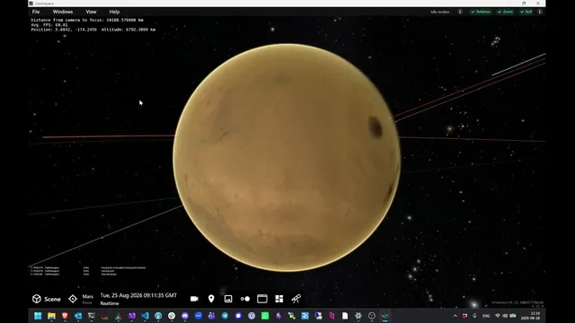
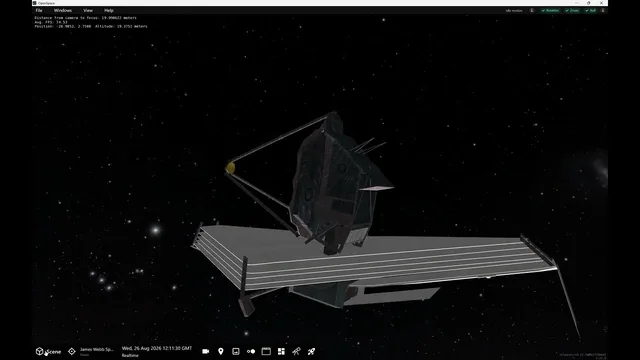
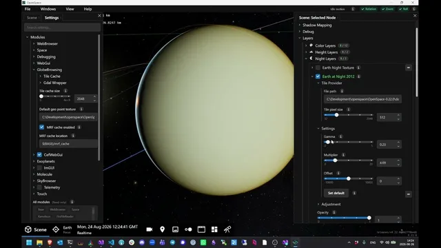
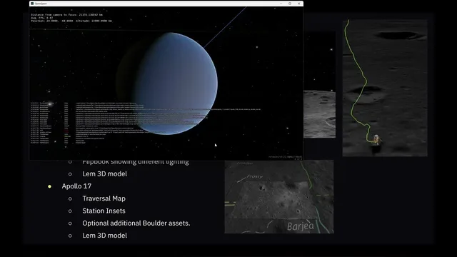
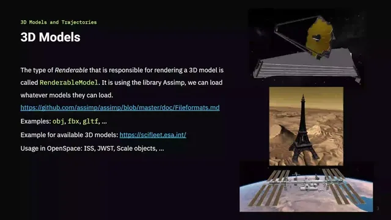
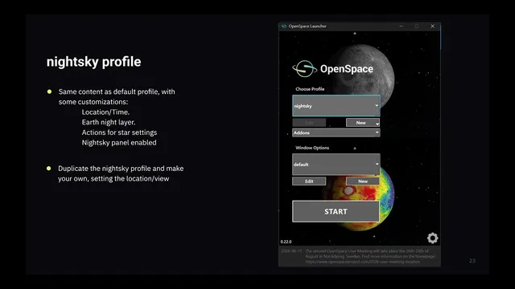
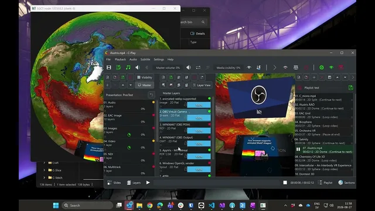
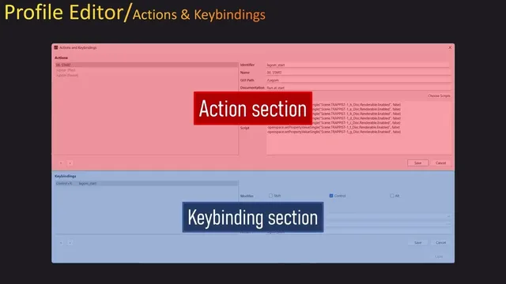
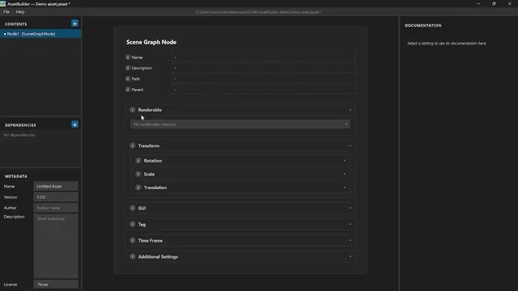
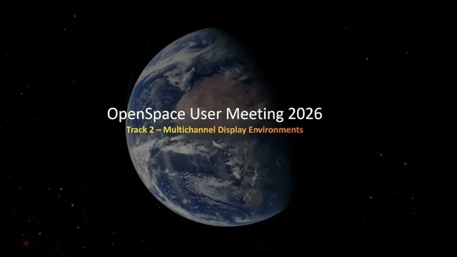



::: {.content-section-narrow #recap}

## A look back

:::: {.recap-intro}

::: {.recap-intro__media}
{fig-alt="Visualization Center C, Norrköping, Sweden"}
:::

::: {.recap-intro__text}
In August 2026, the OpenSpace community gathered in Norrköping, Sweden for the second annual user meeting. OpenSpace users of all levels came together at Visualization Center C for three days of trainings, presentations, hands-on sessions, and networking. Attendees sharpened their skills, picked up new techniques, and connected with their peers over fika.

[Visualization Center C](https://visualiseringscenter.se/en/), a science center run by the Norrköping municipality and Linköping University, is one of the institutions where OpenSpace is developed. Its stereoscopic dome hosts both public shows and university research and teaching, making it a perfect venue for the first European meeting.
:::

::::

:::: {.recap-highlights}

::: {.recap-quote}
> “The community and these meetups really make this product what it is.”

[2026 User Meeting attendee]{.recap-quote__cite}
:::

<dl class="recap-stats">
<div><dt>Attendees</dt><dd>32</dd></div>
<div><dt>Institutions</dt><dd>16</dd></div>
<div><dt>Countries<br>represented</dt><dd>4</dd></div>
</dl>

::::

:::

::: {.content-section-narrow #materials}

<div class="session-header">

## Presentations

<a class="session-header__playlist" href="https://www.youtube.com/playlist?list=PLHVfc7Kfm_2Q" target="_blank" rel="noopener"><iconify-icon icon="lucide:circle-play"></iconify-icon>Watch the full playlist</a>

</div>

<!--
Each session card's media tile is one of:

  Recording (play button over a frame from the talk, saved as a 640×360 .webp in thumbnails/):
    <a class="session-card__media" href="https://www.youtube.com/watch?v=VIDEO_ID&amp;list=PLHVfc7Kfm_2Q" target="_blank" rel="noopener" aria-label="Watch recording: TITLE"><iconify-icon icon="lucide:circle-play"></iconify-icon></a>

  Slides only, no recording:
    <a class="session-card__media session-card__media--slides" href="SLIDES_URL" target="_blank" rel="noopener"><iconify-icon icon="lucide:monitor"></iconify-icon><span>Slides</span></a>

Optional lines below the title:
    <p class="session-card__speaker">Speaker, Institution</p>
    <p class="session-card__links"><a href="SLIDES_URL">Slides</a><a href="HANDOUT_URL">Handout</a><a href="EXAMPLE_URL" download>Example</a></p>
-->

::: {.panel-tabset}

### Wed 26 Aug

<div class="session-grid">

<div class="session-card">
<a class="session-card__media session-card__media--slides" href="slides/openspace-101.pdf" target="_blank" rel="noopener"><iconify-icon icon="lucide:monitor"></iconify-icon><span>Slides</span></a>
<p class="session-card__time">10:45</p>
<h3 class="session-card__title">OpenSpace 101 Workshop: Getting Started</h3>
<p class="session-card__speaker">Micah Acinapura, American Museum of Natural History</p>
<p class="session-card__speaker">Andreas Engberg, Visualization Center C</p>
<p class="session-card__links"><a href="slides/openspace-101.pdf" target="_blank" rel="noopener">Slides</a></p>
</div>

<div class="session-card">
<a class="session-card__media" href="https://www.youtube.com/watch?v=zFRlIG2kF1E&amp;list=PLHVfc7Kfm_2Q" target="_blank" rel="noopener" aria-label="Watch recording: Coding and Scripting"><iconify-icon icon="lucide:circle-play"></iconify-icon></a>
<p class="session-card__time">10:45</p>
<h3 class="session-card__title">Coding and Scripting</h3>
<p class="session-card__speaker">Alex Bock, Linköping University</p>
</div>

<div class="session-card">
<a class="session-card__media" href="https://www.youtube.com/watch?v=nwOCEvJrJMc&amp;list=PLHVfc7Kfm_2Q" target="_blank" rel="noopener" aria-label="Watch recording: OpenSpace 201 Workshop: Included Profiles"><iconify-icon icon="lucide:circle-play"></iconify-icon></a>
<p class="session-card__time">14:00</p>
<h3 class="session-card__title">OpenSpace 201 Workshop: Included Profiles</h3>
<p class="session-card__speaker">Micah Acinapura, American Museum of Natural History</p>
<p class="session-card__links"><a href="slides/openspace-201.pdf" target="_blank" rel="noopener">Slides</a></p>
</div>

<div class="session-card">
<a class="session-card__media" href="https://www.youtube.com/watch?v=BM1qDsEn01k&amp;list=PLHVfc7Kfm_2Q" target="_blank" rel="noopener" aria-label="Watch recording: Maps and Georeferenced Data"><iconify-icon icon="lucide:circle-play"></iconify-icon></a>
<p class="session-card__time">14:00</p>
<h3 class="session-card__title">Maps and Georeferenced Data</h3>
<p class="session-card__speaker">Alex Bock, Linköping University</p>
</div>

<div class="session-card">
<a class="session-card__media" href="https://www.youtube.com/watch?v=dAdRHJyPq_E&amp;list=PLHVfc7Kfm_2Q" target="_blank" rel="noopener" aria-label="Watch recording: OpenSpace 202 Workshop: Included Profiles"><iconify-icon icon="lucide:circle-play"></iconify-icon></a>
<p class="session-card__time">16:30</p>
<h3 class="session-card__title">OpenSpace 202 Workshop: Included Profiles</h3>
<p class="session-card__speaker">Micah Acinapura, American Museum of Natural History</p>
<p class="session-card__links"><a href="slides/openspace-202.pdf" target="_blank" rel="noopener">Slides</a></p>
</div>

<div class="session-card">
<a class="session-card__media" href="https://www.youtube.com/watch?v=Av0I0HvZyhI&amp;list=PLHVfc7Kfm_2Q" target="_blank" rel="noopener" aria-label="Watch recording: 3D Models and Trajectories"><iconify-icon icon="lucide:circle-play"></iconify-icon></a>
<p class="session-card__time">16:30</p>
<h3 class="session-card__title">3D Models and Trajectories</h3>
<p class="session-card__speaker">Malin Ejdbo, Linköping University</p>
<p class="session-card__links"><a href="examples/3d-models-and-trajectories.zip" download>Example</a></p>
</div>

</div>

### Thu 27 Aug

<div class="session-grid">

<div class="session-card">
<a class="session-card__media" href="https://www.youtube.com/watch?v=CAAQ1GJyyb0&amp;list=PLHVfc7Kfm_2Q" target="_blank" rel="noopener" aria-label="Watch recording: The Night Sky"><iconify-icon icon="lucide:circle-play"></iconify-icon></a>
<p class="session-card__time">11:30</p>
<h3 class="session-card__title">The Night Sky</h3>
<p class="session-card__speaker">Micah Acinapura, American Museum of Natural History</p>
<p class="session-card__links"><a href="slides/the-night-sky.pdf" target="_blank" rel="noopener">Slides</a></p>
</div>

<div class="session-card">
<a class="session-card__media" href="https://www.youtube.com/watch?v=Y0FttV01II8&amp;list=PLHVfc7Kfm_2Q" target="_blank" rel="noopener" aria-label="Watch recording: C-Play"><iconify-icon icon="lucide:circle-play"></iconify-icon></a>
<p class="session-card__time">11:30</p>
<h3 class="session-card__title">C-Play</h3>
<p class="session-card__speaker">Erik Sundén, Visualization Center C</p>
</div>

<div class="session-card">
<a class="session-card__media" href="https://www.youtube.com/watch?v=IJ7FY8nOt88&amp;list=PLHVfc7Kfm_2Q" target="_blank" rel="noopener" aria-label="Watch recording: OpenSpace 301 Workshop: Create Custom Profiles"><iconify-icon icon="lucide:circle-play"></iconify-icon></a>
<p class="session-card__time">14:00</p>
<h3 class="session-card__title">OpenSpace 301 Workshop: Create Custom Profiles</h3>
<p class="session-card__speaker">Adam Rohdin, Visualization Center C</p>
<p class="session-card__speaker">Micah Acinapura, American Museum of Natural History</p>
<p class="session-card__links"><a href="slides/openspace-301.pdf" target="_blank" rel="noopener">Slides</a></p>
</div>

<div class="session-card">
<a class="session-card__media" href="https://www.youtube.com/watch?v=mWvMw-NTcaA&amp;list=PLHVfc7Kfm_2Q" target="_blank" rel="noopener" aria-label="Watch recording: AssetBuilder"><iconify-icon icon="lucide:circle-play"></iconify-icon></a>
<p class="session-card__time">16:00</p>
<h3 class="session-card__title">AssetBuilder</h3>
<p class="session-card__speaker">Emma Broman, Linköping University</p>
<p class="session-card__links"><a href="slides/assetbuilder.pdf" target="_blank" rel="noopener">Slides</a></p>
</div>

</div>

### Fri 28 Aug

<div class="session-grid">

<div class="session-card">
<a class="session-card__media" href="https://www.youtube.com/watch?v=M2eMhTaLdYQ&amp;list=PLHVfc7Kfm_2Q" target="_blank" rel="noopener" aria-label="Watch recording: Multichannel Display Environments"><iconify-icon icon="lucide:circle-play"></iconify-icon></a>
<p class="session-card__time">09:30</p>
<h3 class="session-card__title">Multichannel Display Environments</h3>
<p class="session-card__speaker">Adam Rohdin, Visualization Center C</p>
<p class="session-card__links"><a href="slides/multichannel-display-environments.pdf" target="_blank" rel="noopener">Slides</a></p>
</div>

</div>

:::

:::

::: {.content-section-narrow #photos}

## Photos

```{=html}
<div class="content-carousel" id="contentCarousel">
  <div class="content-carousel__track" id="carouselTrack">
    <a class="content-carousel__slide content-carousel__slide--link lightbox" data-gallery="user-meetings-2026" href="/assets/images/user-meetings/2026_OUM_group-photo.webp" style="background-image: url(/assets/images/user-meetings/2026_OUM_group-photo.webp);" aria-label="Group photo of attendees on the stairs to the dome"></a>
    <a class="content-carousel__slide content-carousel__slide--link lightbox" data-gallery="user-meetings-2026" href="/assets/images/user-meetings/2026_OUM_welcome-display.webp" style="background-image: url(/assets/images/user-meetings/2026_OUM_welcome-display.webp);" aria-label="Welcome display at Visualization Center C"></a>
    <a class="content-carousel__slide content-carousel__slide--link lightbox" data-gallery="user-meetings-2026" href="/assets/images/user-meetings/2026_OUM_full-room.webp" style="background-image: url(/assets/images/user-meetings/2026_OUM_full-room.webp);" aria-label="Presenter addressing a full workshop room"></a>
    <a class="content-carousel__slide content-carousel__slide--link lightbox" data-gallery="user-meetings-2026" href="/assets/images/user-meetings/2026_OUM_workshop.webp" style="background-image: url(/assets/images/user-meetings/2026_OUM_workshop.webp);" aria-label="Workshop session with attendees following along on laptops"></a>
    <a class="content-carousel__slide content-carousel__slide--link lightbox" data-gallery="user-meetings-2026" href="/assets/images/user-meetings/2026_OUM_included-profiles-workshop.webp" style="background-image: url(/assets/images/user-meetings/2026_OUM_included-profiles-workshop.webp);" aria-label="Included Profiles workshop with the Solarstorm 2012 profile on screen"></a>
    <a class="content-carousel__slide content-carousel__slide--link lightbox" data-gallery="user-meetings-2026" href="/assets/images/user-meetings/2026_OUM_astrographics-talk.webp" style="background-image: url(/assets/images/user-meetings/2026_OUM_astrographics-talk.webp);" aria-label="Talk with the OpenSpace astrographics paper on screen"></a>
    <a class="content-carousel__slide content-carousel__slide--link lightbox" data-gallery="user-meetings-2026" href="/assets/images/user-meetings/2026_OUM_hands-on-session.webp" style="background-image: url(/assets/images/user-meetings/2026_OUM_hands-on-session.webp);" aria-label="Hands-on session around a conference table"></a>
  </div>

  <div class="content-carousel__controls">
    <div class="content-carousel__dots" id="carouselDots"></div>
    <div class="content-carousel__buttons">
      <button class="content-carousel__button" id="carouselPrev" aria-label="Previous slide">&#8249;</button>
      <button class="content-carousel__button" id="carouselNext" aria-label="Next slide">&#8250;</button>
    </div>
  </div>
</div>
<script src="/assets/js/carousel.js"></script>
```

:::
