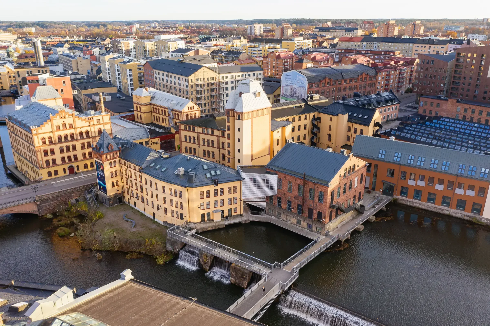
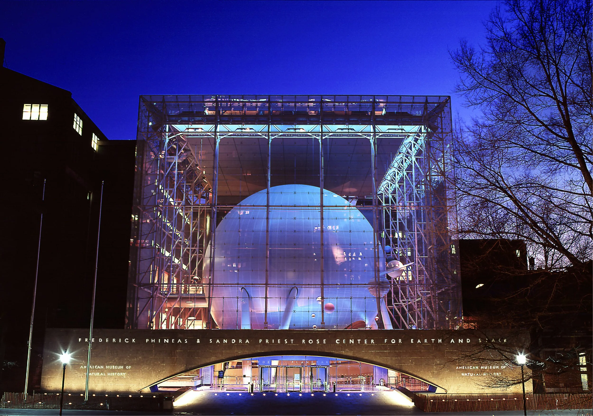

::: {.content-section}

The User Meetings bring together planetarium operators, museum staff, educators, researchers, and developers from across the OpenSpace community. Sessions cover new feature demos, dome integration techniques, use-case showcases, and hands-on training.

:::

```{=html}
<div class="content-section-narrow">
  <div class="page-user-meetings__item">
    <div class="page-user-meetings__media"></div>
    <div>
      <h3>
        <a href="2026/">2026 User Meeting</a>
      </h3>
      <p class="page-user-meetings__location">August 26–28 · Visualization Center C, Norrköping, Sweden</p>
      <p class="page-user-meetings__desc">Our first user meeting in Europe, held at Visualization Center C in Norrköping, Sweden. The community gathered for three days of demos, training sessions, hands-on workshops, and conversation about where the project is headed.</p>
      <a href="2026/" class="page-user-meetings__link">See recap <svg viewBox="0 0 16 16" width="16" height="16" fill="none" stroke="currentColor" stroke-width="1.5" stroke-linecap="round" stroke-linejoin="round"><path d="M2 8h11M9 3l5 5-5 5"/></svg></a>
    </div>
  </div>

  <div class="page-user-meetings__item page-user-meetings__item--past">
    <div class="page-user-meetings__media"></div>
    <div>
      <h3>
        <a href="2025/">2025 User Meeting</a>
      </h3>
      <p class="page-user-meetings__location">July 31 – August 1 · American Museum of Natural History, New York</p>
      <p class="page-user-meetings__desc">The first in-person user meeting, held at AMNH. Planetarium directors, educators, researchers, and developers gathered for two days of sessions, workshops, and hands-on training.</p>
      <a href="2025/" class="page-user-meetings__link">See recap <svg viewBox="0 0 16 16" width="16" height="16" fill="none" stroke="currentColor" stroke-width="1.5" stroke-linecap="round" stroke-linejoin="round"><path d="M2 8h11M9 3l5 5-5 5"/></svg></a>
    </div>
  </div>
</div>
```
